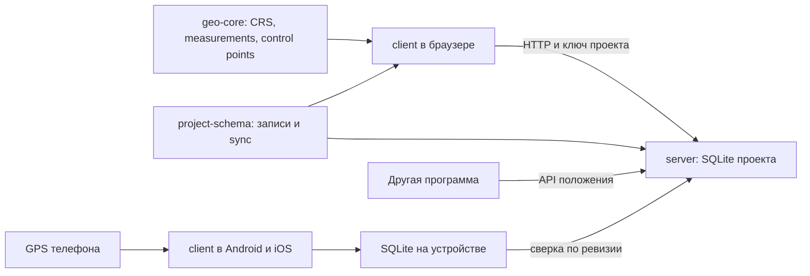

---
todos:
  - id: scaffold
    status: in_progress
    content: 'pnpm-workspace: geo-core, project-schema, server, client, mobile (Android+iOS) и пример расширения; строгие границы пакетов'
  - id: core-geo
    content: 'geo-core: зоны Гаусса–Крюгера с явным датумом, каталог российских CRS, привязка по control points, длина и площадь'
    status: pending
  - id: server-sync
    content: 'project-schema и сервер: идемпотентные операции, конфликты, tombstone, миграции, защищённые токены, OpenAPI, отдельный поток положений, Docker'
    status: pending
  - id: formats
    content: 'packages/formats: общий для client/server код Shapefile/DBF/GeoJSON/archive на ArrayBuffer, без DOM/Node'
    status: pending
  - id: shapefile
    content: 'Shapefile inspect/commit на клиенте и офлайн: zip/shp+shx+dbf+prj+cpg, CRS/encoding decisions, atomic push, writer и round-trip'
    status: pending
  - id: enrollment
    content: 'Подключение устройства: QR/одноразовый код из браузера, per-device token, отзыв и удаление данных устройства'
    status: pending
  - id: projections-ui
    content: 'Системы координат: Web Mercator, зоны Гаусса–Крюгера, сетка, контрольные точки, невязки и положение внутри/снаружи сети'
    status: pending
  - id: situation
    content: 'Живые объекты: отдельный поток положений, знак, статус, направление, ограниченный след, свежесть и нейтральное демо'
    status: pending
  - id: draw-ui
    content: 'English UI: редактор, undo/redo, слои/стили/атрибуты, измерения, coordinate settings, responsive и accessibility'
    status: pending
  - id: android
    content: 'Приложение Android на Capacitor: локальная SQLite, outbox, GPS, защищённые токены, lifecycle, системный экспорт'
    status: pending
  - id: ios
    content: 'Приложение iOS на Capacitor: та же сборка, SQLite, Keychain, Core Location, safe area, Share/Document Picker и проверка сборки в macOS CI'
    status: pending
  - id: gps
    content: 'GPS: положение и точность, отметка с усреднением, полигон и линия по порядку точек'
    status: pending
  - id: phone-live
    content: 'Устройство как live object: opt-in в приложении, положение на сервере, trail, freshness и true-north course'
    status: pending
  - id: background-track
    content: 'Фоновый трек и удалённое управление: Android foreground service, iOS background location, FCM/APNs, desired/actual state, локальная очередь трека'
    status: pending
  - id: extension-api
    content: 'Публичные интерфейсы расширений: importer, symbol pack, position source, basemap и tool panel; отдельный example extension'
    status: pending
  - id: readme
    content: 'English README/docs, tests/CI: запуск, Docker, Android/iOS, API, extensions, migrations, security, limitations, MIT'
    status: pending
name: Картографическое пространство
overview: 'Один расширяемый проект карты для браузера, Android и iOS. Слои из шейпа и с GPS, живые объекты, системы координат и контрольные точки сходятся в одну работу. Ядро, схема проекта, API, интерфейс и мобильная оболочка разделены на пакеты, чтобы проект можно было взять за основу другого приложения.'
isProject: false
---

# Картографическое рабочее пространство

Рабочее English display name продукта — `Cartographic Workspace`. Его можно заменить одной настройкой до публикации; package/bundle identifiers и название в store не размазываются по исходникам.

Один проект карты. Его открывают в браузере, приложении Android и приложении iOS. Слои, живые объекты, настройки проекта и контрольные точки — общая работа. Файл шейпа может лежать только на том устройстве, с которого его загрузили. После загрузки слой входит в проект, и остальные устройства показывают его без исходного файла.

Проект содержит группы слоёв. Каждый слой имеет один тип геометрии: точки, линии или полигоны, а также свои атрибуты и оформление. Это соответствует модели Shapefile и не создаёт неоднозначности при экспорте. Связанные point, line и polygon layers можно сложить в одну group. Points ставятся рукой или снимаются с GPS. Live object живёт отдельно: знак, status, course и короткий trail. Назначение слоёв и объектов задаёт тот, кто ведёт карту; отраслевых ролей в English UI нет.

## Из чего состоит

Один `pnpm-workspace` с небольшими пакетами:

- `geo-core` — библиотека на TypeScript без DOM, React и Node: CRS, зоны Гаусса–Крюгера, datum operations, local registration by control points, geodesic lengths/areas. Units и typed errors входят в публичный контракт. Российские CRS подключаются отдельным каталогом, а не зашиты в смысл ядра.
- `project-schema` — модель `Project → LayerGroup → Layer → Feature → Geometry + Properties + Style`, JSON Schema, операции сверки и типы API. Геодезическая математика от синхронизации не зависит.
- `formats` — чтение и запись Shapefile/DBF, GeoJSON и архива проекта; один код для браузера, телефона и сервера.
- `extension-api` — публичные интерфейсы расширений и реестр.
- `server` — сервер проекта на Hono и SQLite (`better-sqlite3`). Хранит проект, отдаёт и принимает изменения.
- `client` — интерфейс на Vite, React, Tailwind, shadcn/ui и OpenLayers. Одна и та же сборка открывается в браузере и упаковывается в Android и iOS через Capacitor.
- `mobile` — Capacitor-оболочка с папками Android и iOS, разрешения и адаптеры SQLite, GPS, секретов и файлов. Картографический интерфейс из `client` не копируется.
- `extensions/example` — маленькое отдельное расширение, которое добавляет свой набор знаков и импортёр простого JSON. Оно доказывает, что публичные интерфейсы работают вне основного приложения.

Next.js здесь не подходит: Capacitor упаковывает готовые статические файлы, а серверные маршруты Next.js внутрь телефона не попадут. Поэтому сервер и интерфейс разделены.



## Проект как основа других приложений

Расширяемость задаётся небольшими интерфейсами, а не наследованием внутренних React-компонентов:

- `LayerImporter` принимает файл и возвращает обычные записи слоя. Встроенный импортёр шейпа использует тот же интерфейс, что будущие GPX, KML или CSV.
- `SymbolPack` регистрирует знаки и их SVG без изменения карты.
- `PositionSource` приводит внешний поток положений к модели live object. REST API сервера — первый такой источник.
- `BasemapProvider` описывает адрес, атрибуцию и проекцию подложки.
- `ToolPanel` добавляет команду и панель к карте через ограниченный публичный контекст: выбранный проект, слой, карта и операции над записями.

Расширения импортируются при сборке из одного реестра. Загрузки произвольного JavaScript с сервера нет: она потребовала бы песочницы, подписей и отдельной модели безопасности.

Публичные типы экспортируются только из корня пакетов. Внутренние файлы не считаются API. Версия формата проекта хранится в базе; изменения схемы идут нумерованными миграциями. Сервер публикует OpenAPI, а `project-schema` — JSON Schema записей, поэтому клиент на другом языке можно написать без чтения исходников. `geo-core` собирается как ESM и проверяется тестом потребления отдельно в браузере и Node.

Для первого среза стабильными считаются модель записей, HTTP API и пять интерфейсов выше. Визуальные React-компоненты пока не объявляются отдельной библиотекой компонентов: их преждевременная стабильность мешала бы менять интерфейс.

Репозиторий получает лицензию MIT, `CONTRIBUTING.md`, архитектурную схему, руководство «своё расширение» и пример. Это позволяет форкнуть весь продукт или взять только `geo-core` либо `project-schema`.

## Где лежат данные и как они сходятся

Проект хранится в SQLite сервера. Браузер работает с сервером напрямую.

Чтобы телефон видел работу с компьютера не только дома, сервер должен иметь адрес в интернете. Он собирается в один Docker-образ и запускается на любой машине с таким адресом: на своём сервере или на недорогой арендованной машине. Для разработки тот же сервер запускается на компьютере. Телефон подключается один раз: в браузере `Devices → Add device` показывает QR-код и короткий одноразовый код со сроком 10 минут; приложение сканирует QR или принимает адрес сервера и код вручную и обменивает код на собственный отзываемый токен устройства. Долгоживущий токен проекта на телефон не переписывается.

Браузерный клиент работает только онлайн: локальной копии и outbox у него нет, при потере связи он показывает `Server unavailable` и блокирует правки, а не теряет их. При первом открытии браузер показывает экран `Connect to server`: адрес сервера и токен. При первом запуске сервера администратор входит с `ADMIN_TOKEN`, создаёт проект и получает токен редактора; токен хранится в `sessionStorage` по умолчанию, а `Remember on this computer` переносит его в `localStorage` с явным предупреждением.

Учётных записей нет, но проект закрыт случайными токенами не короче 256 бит: отдельно чтение/редактирование проекта и отдельно публикация положения конкретного живого объекта. Токен одного устройства можно отозвать, не меняя доступ остальных. Клиент передаёт токен только в заголовке `Authorization: Bearer`, не в адресе. Сервер хранит хэши и поддерживает ротацию. Android хранит секреты через Keystore, iOS — через Keychain, не в SQLite или обычных Preferences/UserDefaults. Для сервера в интернете обязателен HTTPS через reverse proxy; это также требуется политикой App Transport Security iOS. CORS разрешает только явно указанные web- и Capacitor-origin; сервер валидирует payload, ограничивает частоту, размер тела, число объектов и вершин и не пишет токены в журнал.

Ограничение первого среза сформулировано явно: это токены проекта, а не пользователи и роли. Обладатель токена редактирования имеет полный доступ к проекту. Локальная SQLite на разблокированном или root-устройстве не шифруется и не рассчитана на секретные данные.

Сверка устроена так:

- Каждый feature, live object, control point и project setting — отдельная запись. Layer не хранится одним большим куском: иначе GPS point с телефона и правка соседнего polygon в браузере затирали бы друг друга.
- У записи свой постоянный идентификатор, который создаёт то устройство, где её завели. Поэтому телефон может создавать точки без связи.
- Каждая отправляемая операция содержит уникальные `opId`, `clientId`, `entityId`, `baseVersion`, вид операции и данные. Повтор после сетевого таймаута безопасен: уже принятый `opId` второй раз не применяется. Запись сущности, результат `opId`, tombstone и новая проектная последовательность создаются одной транзакцией.
- Сервер ведёт сквозной номер ревизии. Каждое принятое изменение получает следующий номер. Телефон помнит последний полученный номер и просит только то, что новее. Время на часах телефона для сверки не используется: оно может расходиться с сервером.
- Удаление — это запись-метка «удалено», чтобы второе устройство узнало об удалении, а не вернуло объект обратно. В первом срезе tombstone не очищаются. Удаление слоя создаёт метки слоя и всех его объектов одной пакетной операцией.
- Обычная правка передаёт версию записи, от которой она началась. Если на сервере запись уже новее, сервер не затирает её молча: возвращает конфликт. Клиент хранит свою правку и показывает обе версии с тремя действиями: `Keep server version`, `Overwrite with my version`, `Create a copy`. Для новых GPS-точек конфликта обычно нет: у каждой свой идентификатор.
- Живые положения — не правки одной записи и не входят в общий журнал проекта. Они идут в отдельную ограниченную таблицу и последовательность `positionSeq`. Отсчёт содержит уникальный `fixId`, монотонный номер устройства, `sampledAt`, назначенный сервером `receivedAt`, точность, скорость и направление, если они известны. Запоздавший номер отвергается; свежесть на экране считается по `receivedAt`. Сервер хранит текущее положение и последние N точек.

`POST /api/v1/projects/:projectId/sync/push` принимает пакет операций. `GET /api/v1/projects/:projectId/sync/changes?after=<seq>&limit=<n>` возвращает изменения, следующий cursor, `hasMore`, watermark и версию схемы. Телефон применяет страницу и двигает свой cursor одной локальной транзакцией. Для нового клиента есть пагинированный snapshot.

Приложение сверяется при открытии, по уведомлению о доступной новой ревизии, после своей правки и по кнопке `Sync now`. Уведомление о новой ревизии приходит через SSE `GET /api/v1/projects/:projectId/events` (события `changes-available` и `positions-available` без данных); если поток недоступен или оборвался, используется редкий таймер. Сущность и операция outbox записываются на телефоне одной SQLite-транзакцией до изменения интерфейса. Правки без связи уходят с exponential backoff и jitter, когда сеть вернулась. На экране видно время последней сверки, сколько правок ждёт отправки и есть ли конфликты. Первая загрузка и большие слои передаются страницами со сжатием.

У каждой записи с первого дня есть `projectId`, хотя первый интерфейс открывает один проект. Это оставляет путь к нескольким проектам без переделки базы. Версия формата и миграции относятся ко всему серверу.

Сервер хранит SQLite в постоянном Docker-volume. В интерфейсе есть `Download project archive`: записи, настройки, стили и метаданные CRS складываются в переносимый JSON/GeoJSON-архив. Этот же архив можно восстановить в пустой проект. Шейп остаётся форматом обмена отдельными слоями, а не резервной копией всего проекта.

## Что сознательно не делаем

- Свой движок карты и свой тайловый сервер.
- Учётные записи, роли, свою облачную платформу и PostGIS.
- Привязку к одной профессии или одному сценарию. Слова на экране общие: `Layer`, `Area`, `Object`, `Coordinate system`, `Control point`.
- Гарантированный удалённый запуск принудительно закрытого приложения. Android и особенно iOS могут запретить это на уровне ОС; сервер показывает фактическое состояние, а не делает ложное обещание.

## Подложка и проекция вида

Карту рисует OpenLayers. CRS вида можно сменить, и растровая подложка перепроецируется в неё. `BasemapProvider` задаёт URL, исходную CRS, пределы масштабов, атрибуцию, правила кэша и идентификацию приложения. Для каждой зоны задаются `extent`, `worldExtent` и target tile grid; вид ограничен областью применения CRS. Перепроецированная подложка — визуальный ориентир, не измерительная основа. На Android отдельно проверяется скорость.

Подложка догружается из сети и в проект не записывается. Общедоступный сервер тайлов OpenStreetMap — только для разработки и демо: его политика требует идентифицируемый User-Agent/Referer, а WebView в Capacitor отдаёт origin `capacitor://localhost` / `https://localhost`, который сервер тайлов может отклонить. Поэтому в production и в мобильных приложениях адрес подложки задаётся `BASEMAP_TILE_URL`: либо свой или коммерческий провайдер с ключом, либо встроенный в сервер кэширующий прокси `GET /api/v1/tiles/{z}/{x}/{y}` (включается настройкой, ставит свой User-Agent, соблюдает cache headers и не делает предзагрузку). Общедоступный сервер тайлов OpenStreetMap запрещает выкачивать районы заранее. Поэтому для работы без связи нужна своя подложка в виде файла, а в первом срезе без сети остаются видны слои, объекты и GPS, но не подложка.

Проект хранит CRS по умолчанию и разрешённые операции преобразования. Но текущая CRS отображения — личная настройка устройства: телефон и браузер не переключают вид друг другу. Так же локально хранятся центр и масштаб карты, видимость слоёв, выбранный объект, подложка и открытые панели.

В интерфейсе этот раздел называется `Coordinate systems`, а не просто `Projection`. В нём различаются исходная CRS слоя, внутренние координаты, текущая CRS отображения и локальная система по контрольным точкам:

- Web Mercator (EPSG:3857) — подложка в родной проекции.
- Зарегистрированные в EPSG 6° зоны Гаусса–Крюгера для СК-42, СК-95 и ГСК-2011 — только в своей области применения. Осевой меридиан, scale, false easting/northing, оси и единицы берутся из профиля CRS, а не угадываются из номера. Способ показа восточной координаты выбирается явно: полная либо усечённая запись.

Система координат здесь не украшение. СК-42 и СК-95 считаются на эллипсоиде Красовского от другого начала, чем WGS84. Если просто подставить эллипсоид и не выполнить преобразование датума, слой может уехать на десятки и сотни метров.

В `geo-core` лежит каталог явно реализованных операций, а не один «правильный набор коэффициентов». Профиль фиксирует исходную и целевую CRS, направление, реализацию/эпоху, метод, convention вращений (`coordinate frame` или `position vector`), единицы, цепочку через ПЗ-90.11 при необходимости, область, ожидаемую точность и источник EPSG/нормативного документа. Proj4js не выбирает «лучшую» EPSG-операцию автоматически; приложение выбирает только из проверенного каталога. Ручные семь параметров разрешены как отдельный именованный профиль и сохраняются вместе с convention и направлением.

Геометрия и публичный API используют OGC:CRS84: долгота, затем широта, десятичные градусы. Формальный порядок осей EPSG:4326 `(latitude, longitude)` во внутренних массивах не используется. В профиле каждой российской CRS явно указан порядок `northing/easting` исходных данных и преобразование к библиотечному `(easting, northing)`. Смена CRS вида не переписывает сохранённые объекты.

В режиме Гаусса–Крюгера поверх карты можно включить километровую сетку зоны с подписями. Она показывает, что карта теперь в метрах зоны, а не в градусах.

Растяжение длин растёт к востоку и западу от осевого меридиана, поэтому зона узкая. В подписи видны номер зоны, осевой меридиан и область применения. Если середина экрана ушла в соседнюю зону, это написано рядом с переключателем. 3° зоны, МСК и произвольная WGS84/GK отложены до профилей с явными осевым меридианом, ложными координатами, нумерацией и областью применения.

## Контрольные точки

Это отдельная операция привязки, когда связь местных XY с картой задана известными точками. Преобразование решается между местными XY и одной зафиксированной метрической CRS проекта; градусы, Web Mercator и текущая CRS вида в вычислении не используются.

Контрольная точка содержит местные XY, точные координаты в метрической CRS, источник и примечание. Опорное положение вводится численно, импортируется либо снимается GPS с сохранением reported accuracy. Обычный клик по подложке помечается как приблизительный и не выдаётся за геодезическую опору. В первом срезе считается одно глобальное двумерное преобразование подобия: сдвиг, поворот и единый масштаб. Оно сохраняет углы; аффинное искривление и локальная резиновая деформация не выдаются за эту операцию.

- Одна точка разрешена только в режиме `Translation only`: поворот фиксирован нулём, масштаб — единицей.
- Две точки дают сдвиг, поворот и масштаб ровно, без запаса. Нулевая невязка здесь ничего не проверяет.
- С трёх точек параметры оцениваются взвешенным методом наименьших квадратов: на каждой точке видна невязка, а для сети — RMS, максимум и масштаб в ppm. Отдельную точку можно пометить контрольной и не включать в решение.

Совпадающие контрольные точки, слишком короткий базис и вырожденный набор не принимаются: интерфейс объясняет, почему по ним нельзя устойчиво посчитать преобразование.

Карта показывает выпуклую оболочку сети. Глобальная модель действует одинаково везде, но за пределами области контрольных точек результат является экстраполяцией и не проверен сетью. У выбранной точки показывается `Inside control network` или `Outside control network` и расстояние до её границы. Расстояние до ближайшей опоры остаётся справочным и не называется оценкой точности. Невязки описывают согласованность известных точек, а не гарантированную ошибку в любом месте.

Объект, созданный в local XY, хранит и каноническую geometry CRS84, и исходные XY с `registrationVersion`. После уточнения control points каноническая geometry воспроизводимо пересчитывается из source, а не из уже округлённого результата. Registration profile и control points синхронизируются вместе с проектом.

## Данные пользователя

Шейп — это пачка файлов, не один `.shp`:

- `.shp` — геометрия
- `.shx` — индекс геометрии
- `.dbf` — атрибуты
- `.prj` — проекция, в том числе Гаусс–Крюгер
- `.cpg` — кодировка текста

Импорт через [shpjs](https://github.com/calvinmetcalf/shapefile-js): на вход zip или набор файлов, на выход GeoJSON в CRS84. ZIP может содержать несколько Shapefile: предварительный экран перечисляет их, а человек выбирает нужные; каждый становится отдельным слоем. До записи показан отчёт: тип и число геометрий, multipart, Z/M, projection method, central meridian, scale, false easting/northing, units, axis order, area of use, кодировка и предупреждения. Первый срез работает в 2D; Z/M не теряются молча — импорт требует подтверждения документированного преобразования. Если `.cpg` нет, учитывается DBF LDID, показываются строки и предлагается кодировка. Импорт выполняется атомарно: ошибка не оставляет половину слоя. Каждый объект — отдельная запись проекта. В карточке слоя сохраняются исходный WKT, распознанная CRS, операция и её версия/точность, параметры импорта и атрибуты DBF.

Перед импортом проверяем датум в `.prj`. Частый случай — Пулково 1942 без указанной операции перехода к WGS84. Тогда пересчёт без предупреждения сдвинул бы слой. Импорт останавливается до явного выбора именованной операции с областью и заявленной точностью либо ручных параметров; «универсальных параметров по умолчанию» нет.

Если `.prj` нет, человек явно выбирает CRS и операцию либо применяет профиль контрольных точек. Отсутствие `TOWGS84` само по себе не считается ошибкой `.prj`: WKT обычно описывает CRS, а операция выбирается отдельно.

`shpjs` используется только для чтения; для записи выбирается отдельная writer-библиотека. Слой выгружается zip-архивом (`shp`, `shx`, `dbf`, `prj`, `cpg`). Один шейп содержит только один тип геометрии. DBF ограничивает имена полей десятью символами и плохо хранит длинные строки, Unicode и `null`: перед экспортом показаны преобразования, уникальные короткие имена и таблица соответствия. По умолчанию экспорт идёт в WGS84; можно выбрать исходную CRS, если операция обратима. Повторный импорт сохраняет геометрию и явно перечисленные поддерживаемые атрибуты.

В браузере ZIP скачивается как Blob. В мобильных приложениях он создаётся во временном каталоге и отдаётся через системный Share Sheet. `Save as…` использует Android `ACTION_CREATE_DOCUMENT` или iOS Document Picker, а не прямую запись в произвольную папку.

GeoJSON поддерживается как второй, более простой формат импорта и экспорта. Он удобен для API, тестов и разработчиков расширений; шейп остаётся главным пользовательским форматом первого среза.

## Рисование и измерения

На карте можно создать, выбрать, переместить, изменить вершины и удалить точку, линию или полигон. Есть undo/redo текущей сессии, приближение ко всем данным или одному слою, порядок и прозрачность слоёв, базовый цвет/контур, подпись из выбранного атрибута, легенда и поиск по атрибутам. Координата выбранной точки копируется одним действием. Касанием это работает на телефоне, мышью и клавиатурой — в браузере.

У линии в карточке видна длина, у полигона — периметр и эллипсоидальная площадь. Вычисления идут через актуальный `geographiclib-geodesic`: длина — сумма обратных геодезических задач по сегментам, площадь учитывает внешние кольца, отверстия и MultiPolygon, периметр — все границы. Это не наклонная и не кадастровая площадь. Для невалидного или самопересекающегося контура обычная площадь не публикуется. Линейка использует тот же алгоритм.

## Live objects

Отдельная таблица проекта. Объекты обновляются часто, слои почти нет.

Поля: имя, знак, статус, CRS84 longitude/latitude, course, время. Последние положения копятся коротким следом (десятки точек, не архив). Course — градусы по часовой стрелке от истинного севера; экранный угол значка получается проецированием короткой геодезической линии, поэтому учитывает меридианное сближение в зоне Гаусса–Крюгера.

Знаки — маленький свой набор SVG, который легко дополнить: точка, человек, транспорт, техника. На карте это пиктограмма с цветом статуса и стрелкой направления. Объект, от которого давно нет положения, рисуется бледнее, а в карточке видно, сколько времени прошло.

Человек может вводить координаты в текущей CRS интерфейса или местной системе, после чего клиент явно преобразует их в CRS84. Публичный API положения всегда принимает CRS84 longitude/latitude и никогда не зависит от меняющейся CRS вида.

Положения обновляются отдельным bounded endpoint/polling cursor, не общей сверкой. Нейтральный demo stream генерирует сервер только при `DEMO_LIVE_STREAM=true` (по умолчанию выключен) и только для demo project; клиенты сами движение не имитируют. Другая программа публикует положение через versioned endpoint `POST /api/v1/live-objects/:objectId/positions` с ограниченным publication token.

## GPS

Мобильное приложение запрашивает доступ к положению через Android Location или iOS Core Location. Сохраняются координаты, timestamp, источник (`gps`, fused, network), признак coarse/precise и сообщённая ОС horizontal accuracy. Это доверительный радиус с платформенной семантикой, а не гарантированная ошибка: Android обычно сообщает оценку около 68%, Web Geolocation — 95%. На карте он строится как геодезический круг и затем перепроецируется, а не как плоский радиус текущей карты. Кнопка `Center on location` сдвигает карту к точке.

Человек создаёт point layer или выбирает существующий и нажимает `Mark here`. В слой пишется point с CRS84 longitude/latitude, временем, source и reported accuracy. Имя задаётся отдельно. На экране coordinate показывается в текущей CRS display; при active local registration рядом видны local XY.

Отметка по одному отсчёту гуляет на несколько метров. В режиме усреднения приложение берёт только уникальные свежие precise-отсчёты, переводит их в локальную ENU-плоскость, отбрасывает выбросы по зафиксированному робастному правилу и считает взвешенное среднее. В точку записываются число отсчётов, длительность, source, медианная reported accuracy и RMS-разброс. Алгоритм детерминирован и покрыт тестами; разброс не объявляется точностью результата.

По точкам одного слоя есть две сборки, без прочих геометрических операций. `Build polygon` соединяет их в порядке списка и замыкает контур. Точки для этого нужны хотя бы три. `Build line` соединяет их в том же порядке и не замыкает. Исходные точки остаются. Результат записывается в новый связанный полигональный или линейный слой той же группы, сразу с длиной или площадью и ссылками на исходные точки.

Порядок в списке — это порядок обхода. Его можно поменять, подняв или опустив точку, и собрать фигуру заново. Если обход пересекает сам себя, фигура всё равно строится как есть, а в карточке написано, что контур самопересекается и площадь у него неправильная. Программа не угадывает другой порядок.

Слой с GPS-точками входит в проект наравне с загруженным шейпом. После сверки те же точки и собранный контур видны в браузере на компьютере. Слой можно выгрузить в шейп.

Пока приёмник не дал положение, кнопка отметки не ставит точку и пишет, что положения ещё нет. Отказ в доступе к GPS показан на экране вместе с тем, где его включить. Если точек для полигона меньше трёх, сборка объясняет, сколько ещё не хватает.

## Устройство как live object

В приложении есть выключенный по умолчанию переключатель `Share my live location`. Пока он включён, на карте постоянно видна английская пометка, что location публикуется.

При первом включении mobile app заводит live object: editable device name и symbol из общего набора. Object ID хранится на устройстве, поэтому после перезапуска продолжаются тот же object и trail, а не создаётся новый.

Положение уходит через `POST /api/v1/live-objects/:objectId/positions`. Отправка идёт по heartbeat либо когда смещение превышает максимум заданного порога и порога, вычисленного из reported accuracy; шум стоящего устройства не превращается в движение. Вместе с положением уходят source, accuracy, speed и course, если они известны.

В браузере такой объект выглядит как остальные живые объекты: знак, след, время последнего положения. Когда положение давно не приходило, знак бледнеет. Так видно, что телефон выключил передачу, закрыл приложение или потерял связь. Несколько телефонов с доступом к проекту и своими токенами публикации видны одновременно.

На самом телефоне его собственный объект не рисуется второй раз поверх точки GPS. Остальные телефоны и объекты на нём видны.

Без связи живое положение не копится в очередь: устаревшая точка в обстановке вводит в заблуждение. Когда связь вернулась, уходит текущее положение. Отметки `Mark here` при этом по-прежнему копятся и уходят со сверкой, это работа, а не обстановка.

В обычном режиме передача идёт, пока приложение активно. На Capacitor-событии `appStateChange(false)` Android и iOS останавливают JavaScript GPS-watch, запросы и таймеры. При возврате приложение проверяет разрешения, открывает и мигрирует SQLite, запускает сверку и только затем GPS. При уничтожении процесса специальный callback не нужен: обычные правки и outbox уже записаны транзакционно.

Различия платформ скрыты за восемью интерфейсами из раздела «Платформенные адаптеры» (`DataStore`, `SyncEngine`, `FileExport`, `LocationProvider`, `SecretStore`, `AppLifecycle`, `PushChannel`, `BackgroundTracker`). Браузер использует HTTP и Web API, Android/iOS — SQLite и плагины Capacitor с небольшими нативными адаптерами. Одна React-сборка выбирает адаптер во время запуска; нативные плагины в браузере не инициализируются.

Для iOS задаются строки разрешения геолокации в `Info.plist`, safe-area для выреза и домашнего индикатора, Keychain для токенов, Core Location, Share Sheet и Document Picker.

## Фоновый трек и команды сервера

Фоновая запись — отдельный режим, который человек заранее разрешает на самом устройстве. В настройках есть `Allow remote track control`, а во время записи операционная система и приложение постоянно показывают, что геолокация используется. Сервер не обходит разрешения ОС и не скрывает слежение.

Сервер хранит для каждого устройства два состояния:

- `desiredState` — что запросил оператор: выключено, только текущее положение или запись трека; вместе с профилем точности, минимальным расстоянием, интервалом и временем автоматического выключения;
- `actualState` — что подтвердило устройство: работает, остановлено, нет разрешения, приложение закрыто, устройство offline, последняя связь и заряд батареи.

Команда имеет идентификатор, срок действия и запись в журнале аудита. Сервер отправляет уведомление через FCM на Android или APNs на iOS; приложение также забирает ожидающую команду при следующей связи. Команда «стоп» не считается исполненной, пока устройство её не подтвердило. Если устройство offline, сервер так и показывает `Pending delivery`.

На Android запись выполняет нативный foreground service типа `location` с постоянным уведомлением. Нужны разрешения precise/background location и foreground-service location. После явного согласия пользователя сервис может продолжать работу при свёрнутом интерфейсе. Однако современные версии Android ограничивают запуск foreground service из полностью фонового состояния: push иногда только покажет уведомление `Tap to start tracking`, которое пользователь должен нажать (подробности — в разделе «Управление устройствами и фоновый трек»). После force-stop ОС не принимает команды до ручного запуска приложения.

На iOS используется нативный Core Location с Background Mode `location` и разрешением Always. После включения пользователем приложение может продолжать запись в фоне и при блокировке экрана. APNs silent push не гарантирует немедленный запуск, а после принудительного закрытия пользователем удалённо запустить запись нельзя. Сервер в этом случае оставляет `desiredState=track`, но показывает `actualState=appTerminated/offline`.

Фоновую геолокацию реализует нативный модуль Kotlin/Swift, а не JavaScript в WebView. Он пишет отсчёты в мобильную SQLite с монотонным номером. Трек, в отличие от «живой точки», сохраняется без сети и отправляется пакетами после восстановления связи; повторная отправка идемпотентна. Ограничены срок и объём локального хранения. У отсчёта есть CRS84 longitude/latitude, время измерения, source, horizontal accuracy, altitude/vertical accuracy при наличии, speed, bearing и battery.

У профиля записи три понятных режима: экономичный, сбалансированный и точный. Отсчёт принимается по фильтру расстояния с учётом reported accuracy, поэтому шум стоящего телефона не выглядит движением. Сервер может изменить профиль или запросить одно текущее положение. Автоматический срок выключения и локальный аварийный переключатель защищают от забытой бесконечной записи.

Для FCM/APNs нужны отдельные ключи и Apple Push capability. Репозиторий содержит шаблоны конфигурации и режим без push, где команда применяется при следующем открытии/сеансе связи. Публикация в Google Play/App Store требует обоснования фоновой геолокации и может быть отклонена магазином, если функция не объяснена пользователю.

## Экран

Все пользовательские экраны, ошибки, нативные permission-описания, README и примеры — на английском. Отраслевых подписей нет. Стартовый экран создаёт проект, открывает недавний, дублирует его или удаляет с подтверждением. В браузере на широком окне панели стоят сбоку от карты. В мобильном приложении карта занимает всё окно, а инструменты открываются нижними панелями с учётом Android navigation bar и iOS safe-area. Кнопки не меньше 48 px; наведение мышкой нигде не требуется.

- Карта на весь экран, подложка снизу, слои заливкой, значки сверху.
- На карте постоянно видны только `Layers`, `Add`, `Measure` и `My location`. Остальное появляется в выбранном режиме.
- Панель слоёв: импорт, создание, порядок, прозрачность, стиль, подпись, видимость, приближение, атрибуты, экспорт и удаление.
- Режим `Field collection`: положение и reported accuracy, `Center on location`, `Mark here`, `Average position`, `Build line`, `Build polygon`.
- Модуль `Live objects`: список объектов, status, время последнего положения, отметка `Device`, добавление объекта и отдельный демонстрационный режим.
- В приложении: `Share my live location`, имя и знак устройства, постоянная пометка, пока положение уходит.
- Панель `Devices`: `Add device` с QR-кодом и одноразовым кодом, `Remove device`, `desiredState` и `actualState` рядом, последнее подтверждение, батарея, разрешения, `Request current location`, `Start track`, `Stop track`, профиль и срок автовыключения.
- `Project settings → Coordinate systems`: Web Mercator или зона Гаусса–Крюгера, операция преобразования, километровая сетка и control points. На мобильном диагностика относится к центру карты или выбранной точке, а не к отсутствующему курсору.
- Строка сверки: время последней сверки, число pending changes, conflicts и `Sync now`.
- Пустые и ошибочные состояния (`Invalid Shapefile`, `Unknown datum`, `Basemap unavailable`, `Invalid project token`, `Server unavailable — showing the local copy`) написаны прямо на экране.

## Язык и локализация

Единственная поставляемая локаль — `en`. Компоненты не содержат пользовательские строки напрямую: они получают их по стабильным ключам из [apps/client/src/i18n/en.ts](apps/client/src/i18n/en.ts). Форматирование чисел, дат, единиц и координат проходит через [apps/client/src/i18n/format.ts](apps/client/src/i18n/format.ts). Все времена хранятся и передаются в UTC (ISO 8601 с `Z`), а показываются в локальном часовом поясе устройства. Единицы только метрические: m/km, m²/ha/km², km/h; градусы — decimal degrees с выбором DMS в настройках вида. Сервер возвращает машинный `error.code`, структурированные детали и английский fallback; клиент локализует по коду. Android `strings.xml`, iOS `Localizable.strings`, permission descriptions, уведомление foreground service и push-сообщения тоже английские.

Архитектура допускает будущие `de.ts`, `ru.ts` и другие каталоги, но переключателя языка и дополнительных переводов в первом выпуске нет. CI проверяет, что ключи `en` полны и что в UI-коде нет неучтённых строк.

Отдельный демонстрационный проект содержит нейтральные точки интереса, маршрут, территорию и несколько живых объектов. Он создаётся один раз на сервере; каждый клиент не добавляет собственные дубликаты.

## Целевая структура репозитория

Другой агент должен создать один pnpm workspace, а не несколько несвязанных проектов:

```text
/
├─ package.json
├─ pnpm-workspace.yaml
├─ tsconfig.base.json
├─ eslint.config.mjs
├─ vitest.workspace.ts
├─ .env.example
├─ docker-compose.yml
├─ Dockerfile
├─ apps/
│  ├─ server/
│  │  ├─ src/index.ts
│  │  ├─ src/app.ts
│  │  ├─ src/config.ts
│  │  ├─ src/auth/
│  │  ├─ src/db/
│  │  ├─ src/routes/
│  │  ├─ src/services/
│  │  └─ migrations/
│  ├─ client/
│  │  ├─ src/main.tsx
│  │  ├─ src/app/
│  │  ├─ src/map/
│  │  ├─ src/features/
│  │  ├─ src/platform/
│  │  ├─ src/i18n/
│  │  └─ src/components/ui/
│  └─ mobile/
│     ├─ capacitor.config.ts
│     ├─ android/
│     ├─ ios/
│     └─ native-plugins/
├─ packages/
│  ├─ geo-core/
│  │  ├─ src/index.ts
│  │  ├─ src/crs/
│  │  ├─ src/operations/
│  │  ├─ src/registration/
│  │  ├─ src/geodesy/
│  │  └─ test/fixtures/
│  ├─ project-schema/
│  │  ├─ src/index.ts
│  │  ├─ src/entities.ts
│  │  ├─ src/sync.ts
│  │  ├─ src/api.ts
│  │  ├─ src/device-state.ts
│  │  └─ schemas/
│  ├─ formats/
│  │  ├─ src/index.ts
│  │  ├─ src/shapefile/
│  │  ├─ src/dbf/
│  │  ├─ src/geojson/
│  │  └─ src/archive/
│  └─ extension-api/
│     ├─ src/index.ts
│     └─ src/registry.ts
├─ extensions/example/
├─ fixtures/
│  ├─ shapefile/
│  ├─ geojson/
│  ├─ crs/
│  └─ sync/
├─ scripts/ci/
│  ├─ check.sh
│  ├─ android.sh
│  └─ ios.sh
├─ docs/
│  ├─ architecture.md
│  ├─ coordinate-systems.md
│  ├─ sync-protocol.md
│  ├─ extension-guide.md
│  ├─ mobile-background-location.md
│  ├─ deployment.md
│  └─ limitations.md
└─ ci/
   └─ README.md
```

CI не привязан к GitHub: вся логика лежит в `scripts/ci/*.sh`, а конфигурация конкретного CI-провайдера — тонкая обёртка, которая их вызывает. `check.sh` и `android.sh` идут на Linux runner; `ios.sh` требует macOS runner с Xcode. Если macOS runner у выбранного провайдера недоступен, это записывается в [docs/limitations.md](docs/limitations.md), а iOS-сборка не объявляется проверенной.

Корневые команды в [package.json](package.json):

- `pnpm dev` — server и browser client;
- `pnpm build` — все TypeScript/ESM пакеты, server и статический client;
- `pnpm typecheck`, `pnpm lint`, `pnpm test`, `pnpm test:e2e`;
- `pnpm mobile:sync`, `pnpm android:build`;
- `pnpm ios:prepare` — генерирует/синхронизирует Xcode-проект; фактический `xcodebuild` выполняется macOS CI;
- `pnpm db:migrate`, `pnpm db:verify`;
- `pnpm api:generate` — OpenAPI и JSON Schema из канонических типов.

Нельзя импортировать внутренние пути чужого пакета. ESLint boundary rule разрешает только публичные экспорты [packages/geo-core/src/index.ts](packages/geo-core/src/index.ts), [packages/project-schema/src/index.ts](packages/project-schema/src/index.ts), [packages/formats/src/index.ts](packages/formats/src/index.ts) и [packages/extension-api/src/index.ts](packages/extension-api/src/index.ts). `formats` зависит только от `geo-core` и `project-schema`.

## Каноническая модель проекта

Типы живут в [packages/project-schema/src/entities.ts](packages/project-schema/src/entities.ts), JSON Schema генерируется в [packages/project-schema/schemas](packages/project-schema/schemas). Все идентификаторы — UUIDv7 либо другой сортируемый глобально уникальный ID, создаваемый клиентом.

```ts
type Project = {
  id: string
  name: string
  schemaVersion: number
  defaultCrsProfileId: string | null
  createdAt: string
  updatedAt: string
}

type LayerGroup = {
  id: string
  projectId: string
  name: string
  order: number
}

type Layer = {
  id: string
  projectId: string
  groupId: string | null
  name: string
  geometryType: 'Point' | 'LineString' | 'Polygon'
  style: LayerStyle
  source: LayerSourceMetadata | null
  status: 'importing' | 'ready'
  derivedFrom?: { layerId: string; pointIds: string[] }
  order: number
}

type Feature = {
  id: string
  projectId: string
  layerId: string
  geometry: GeoJSONGeometryInCrs84
  properties: Record<string, JsonValue>
  sourceGeometry?: {
    coordinates: unknown
    crsProfileId: string
    registrationVersion?: number
  }
}
```

`Project`, `LayerGroup`, `Layer`, `Feature`, `ControlNetwork`, `ControlPoint`, `CrsOperationProfile`, `LiveObject` и project settings — синхронизируемые сущности. Локальные настройки вида (`view CRS`, center, zoom, layer visibility, selected feature, basemap, opened panels) не входят в проект.

Дополнительные модели:

- `ControlNetwork`: фиксированная target metric CRS, версия, параметры similarity transform, RMS/max residual;
- `ControlPoint`: local XY, target XY, uncertainty/weight, source, role `fit|check`;
- `LiveObject`: metadata, symbol, status, publication token reference; без потока точек внутри;
- `PositionFix`: отдельный bounded stream с `positionSeq`;
- `Device`: platform, display name, push token metadata, permissions summary, lastSeen, actual state;
- `DeviceCommand`: desired action, profile, expiration, created/acknowledged timestamps and result;
- `TrackSession`: device, start/end, requested profile, actual state, point count;
- `TrackPoint`: session, monotonic sequence, CRS84 coordinate, timestamps, accuracy/source/speed/course/altitude/battery.

Поле `version` и tombstone относятся к sync-envelope, а не дублируются внутри пользовательского JSON.

## Серверная и мобильная базы

Миграции сервера находятся в [apps/server/migrations](apps/server/migrations). Минимальные таблицы:

- `projects`;
- `project_tokens` (`id`, `project_id`, `kind`, `hash`, `device_id`, `revoked_at`);
- `enrollment_codes` (`id`, `project_id`, `hash`, `expires_at`, `attempts`, `redeemed_at`);
- `entities` (`project_id`, `entity_type`, `entity_id`, `version`, `payload_json`, `deleted`, `change_seq`);
- `project_changes` (`project_id`, `seq`, entity envelope);
- `accepted_operations` (`project_id`, `op_id`, `client_id`, result) для идемпотентности;
- `devices`, `device_push_tokens`, `device_commands`;
- `live_objects`, `live_positions`;
- `track_sessions`, `track_points`;
- `schema_migrations`.

SQLite сервера работает в WAL mode с `busy_timeout`, foreign keys и одной пишущей репликой. Несколько контейнеров не должны писать в один файл. Все последовательности и результаты операций назначаются внутри транзакции.

Локальная SQLite мобильного приложения содержит:

- `local_entities`;
- `outbox_operations`;
- `sync_state` (`projectId`, `lastPulledSeq`, snapshot cursor, schema version);
- `conflicts`;
- `local_track_sessions`, `local_track_points`, `track_upload_state`;
- `device_state`;
- `app_settings`;
- `local_schema_migrations`.

Секреты в SQLite не лежат: Android использует Keystore, iOS — Keychain. Изменение сущности и добавление outbox-операции происходят одной локальной транзакцией.

## Протокол синхронизации

Контракты определены в [packages/project-schema/src/sync.ts](packages/project-schema/src/sync.ts), реализация сервера — в [apps/server/src/routes/sync.ts](apps/server/src/routes/sync.ts), мобильный движок — в [apps/client/src/platform/native/sync-engine.ts](apps/client/src/platform/native/sync-engine.ts).

Операция:

```ts
type SyncOperation = {
  opId: string
  clientId: string
  projectId: string
  entityType: EntityType
  entityId: string
  kind: 'create' | 'update' | 'delete'
  baseVersion: number | null
  payload?: unknown
}
```

Порядок:

1. Native client сначала транзакционно пишет сущность и outbox.
2. `POST /api/v1/projects/:projectId/sync/push` принимает пакет `{ operations, atomic?: boolean }`. Без `atomic` каждая операция получает свой результат; с `atomic: true` один conflict или ошибка отклоняет весь пакет.
3. Повторный `opId` возвращает сохранённый результат без повторного применения.
4. `update/delete` принимается только при совпадении `baseVersion`; иначе результат `conflict` содержит текущую серверную версию.
5. Принятая операция атомарно обновляет entity, tombstone/change, `changeSeq` и accepted operation.
6. `GET /api/v1/projects/:projectId/sync/changes?after=<seq>&limit=<n>` возвращает `changes`, `nextCursor`, `hasMore`, `watermark`, `schemaVersion`.
7. Клиент применяет страницу и двигает cursor одной транзакцией.
8. Новый клиент получает пагинированный snapshot. Клиент с несовместимой схемой останавливается и показывает upgrade-required.
9. Tombstone в первом выпуске не очищаются.

Конфликт не разрешается автоматически. Экран показывает server/local versions и действия `Keep server version`, `Overwrite with my version`, `Create a copy`. Последнее создаёт новый entity ID.

Обычный sync запускается при открытии/resume, после локальной правки с debounce, при восстановлении сети, по push «доступна ревизия», умеренным foreground timer и вручную. Retry использует exponential backoff с jitter. Никаких частых запросов для обычных сущностей.

## HTTP API

OpenAPI формируется из [packages/project-schema/src/api.ts](packages/project-schema/src/api.ts) и доступен как `/api/v1/openapi.json`.

Системные маршруты:

- `GET /health/live`;
- `GET /health/ready`;
- `GET /api/v1/capabilities`.

Администрирование (admin token):

- `GET/POST /api/v1/projects`;
- `POST /api/v1/projects/:id/duplicate`;
- `DELETE /api/v1/projects/:id`;
- `POST /api/v1/projects/:id/tokens`;
- `DELETE /api/v1/projects/:id/tokens/:tokenId`;
- `POST /api/v1/projects/:id/archive/export`;
- `POST /api/v1/projects/archive/import`.

Данные проекта:

- sync push/changes/snapshot;
- `POST /api/v1/projects/:id/import/inspect`;
- `POST /api/v1/projects/:id/import/commit`;
- `POST /api/v1/projects/:id/export/layers`;
- `GET /api/v1/projects/:id/live-objects`;
- `POST /api/v1/projects/:id/live-objects`;
- `POST /api/v1/live-objects/:objectId/positions`;
- `GET /api/v1/projects/:id/positions?after=<positionSeq>`;
- `GET /api/v1/projects/:id/events` — SSE только с уведомлениями `changes-available` / `positions-available` и текущими номерами; данные клиент забирает обычными endpoints. Токен передаётся в заголовке через `fetch`-stream, не через `EventSource` с токеном в URL;
- `POST /api/v1/projects/:id/enrollments`, `POST /api/v1/enrollments/redeem`;
- device status/commands, `DELETE /api/v1/projects/:id/devices/:deviceId` (отзыв токена, удаление push token, live object и треков устройства);
- track session/point batch/finalize endpoints.

Живые позиции и track batches не идут через `project_changes`. Метаданные live object и готовая линия, сохранённая из трека в слой, идут через обычный sync.

Все входы валидируются JSON Schema. Координаты API — только CRS84 longitude/latitude. Ошибки имеют `code`, `message` на английском, `details` и request ID.

## Аутентификация и безопасность

[apps/server/src/auth](apps/server/src/auth) реализует:

- `ADMIN_TOKEN` для создания/удаления проектов и ротации ключей;
- project editor/read token;
- per-device token, выданный через одноразовый enrollment code; он даёт editor-доступ к проекту и publication только своего live object;
- отдельный publication-only token для внешних программ (`PositionSource` через REST);
- одноразовые enrollment codes хранятся хэшами, имеют срок, ограничение попыток и гасятся атомарно.

Токены не короче 256 случайных бит, передаются только как Bearer header, на сервере хранятся хэши и сравниваются безопасно. Токены не появляются в URL, telemetry и логах. Есть revoke/rotate, CORS allowlist, CSP, body/geometry limits, rate limits для auth, positions и commands.

Production требует HTTPS. Docker-пример не изобретает свой TLS, а документирует reverse proxy. Локальный HTTP разрешён только development-конфигурацией.

Threat model первого выпуска: нет пользователей и ролей; владелец editor token может менять весь проект. Локальная SQLite не использует SQLCipher и читаема на разблокированном/rooted устройстве. Это явно указано в [docs/limitations.md](docs/limitations.md).

## Геодезическая реализация

[packages/geo-core](packages/geo-core) не зависит от React, OpenLayers, SQLite, Node или project sync.

Публичные типы:

- `Crs84Coordinate = readonly [longitude: number, latitude: number]`;
- `ProjectedCoordinate = readonly [easting: number, northing: number]`;
- branded units для degrees/metres/ppm;
- `CrsProfile`, `CoordinateOperationProfile`, `TransformResult`, typed errors.

Первый выпуск поддерживает:

- OGC:CRS84 как внутренний/API формат;
- EPSG:3857 как CRS базового вида;
- только проверенные зарегистрированные 6° зоны СК-42, СК-95 и ГСК-2011 в своих area of use.

3° зоны, МСК, WGS84/GK, пользовательские CRS, grid corrections, высоты/геоид и эпохозависимые сантиметровые преобразования не входят. Каталог профилей строится из проверенных EPSG/нормативных записей, но код не предполагает закономерность номера EPSG.

Каждый operation profile хранит direction, source/target CRS, realization/epoch, rotation convention, units, pipeline/composition, area and expected accuracy. Если цепочка нормативно идёт через ПЗ-90.11, она реализуется именно цепочкой. Proj4js используется для явных определений, но не выбирает операцию автоматически.

Golden tests сравнивают результат с независимым PROJ/эталонными значениями. Эталоны генерируются один раз скриптом через PROJ и коммитятся в [packages/geo-core/test/fixtures](packages/geo-core/test/fixtures), чтобы CI не зависел от PROJ. Для каждой из трёх систем проверяются первая и последняя зарегистрированные зоны и несколько промежуточных, а дешёвый параметрический тест проходит все зоны каталога: центр и края зоны, обе стороны осевого меридиана, прямой/обратный ход, full/truncated easting и axis swap. Допуск теста равен точности численного алгоритма, а не заявленной точности исходной геодезической сети.

Local registration решается в фиксированной метрической CRS. Модель:

```text
E = tx + s * (cosθ * x - sinθ * y)
N = ty + s * (sinθ * x + cosθ * y)
```

Одна control point означает translation-only (`s=1`, `θ=0`). Две определяют similarity без контроля. Для 3+ применяется weighted least squares, публикуются scale ppm, residuals, RMS, maximum. Check points исключаются из fit. Проверяются совпадения, короткий baseline и вырожденная/почти коллинеарная сеть.

Слой, созданный в local XY, сохраняет исходные координаты и registration version. При изменении сети CRS84 пересчитывается из source, а не из старого результата.

Измерения через `geographiclib-geodesic` поддерживают holes и multipart. Невалидным/self-intersecting polygon обычная площадь не показывается.

## Импорт, экспорт и резервные копии

Чтение и запись форматов живут в отдельном пакете [packages/formats](packages/formats) (Shapefile, DBF, GeoJSON, project archive) без DOM и Node-специфичных API, с входом `ArrayBuffer`/`Uint8Array`. Один и тот же код работает в браузере, в WebView телефона и на сервере.

Импорт выполняется на клиенте: файл разбирается локально, а результат commit уходит одним push-пакетом с `atomic: true` (сервер применяет все записи слоя или ни одной). Большой слой делится на атомарные пакеты не по объектам, а через `Layer` в статусе `importing`, который становится видимым только последней операцией `update` после всех частей. Поэтому телефон может импортировать шейп без связи — слой сразу виден локально и уходит на сервер со сверкой. Серверные `import/inspect` и `import/commit` используют тот же пакет и нужны для API-клиентов и автоматизации; UI ими не обязан пользоваться.

Импортёр Shapefile реализует `LayerImporter` и имеет два шага:

1. `inspect`: безопасно читает ZIP, перечисляет datasets, shape type/count, bounds, WKT, CRS recognition, datum operation requirement, DBF encoding preview/LDID, fields, multipart/Z/M and warnings;
2. `commit`: после явного выбора datasets, encoding, CRS and operation атомарно создаёт layers/features.

Первый выпуск 2D. Z/M не отбрасываются без предупреждения и подтверждения. ZIP path traversal, archive bombs, limits по размеру/объектам/вершинам проверяются до commit.

`shpjs` используется только для чтения. Для записи сначала оценивается `@mapbox/shp-write` (поддержка всех трёх типов, multipart, holes, `.cpg`, размер). Если она не покрывает round-trip fixtures, в `formats` пишется минимальный собственный writer SHP/SHX/DBF: формат простой и хорошо описан в ESRI Shapefile Technical Description. Решение и причина фиксируются в [docs/architecture.md](docs/architecture.md). DBF field names сокращаются до уникальных 10 символов; manifest в ZIP хранит соответствие, преобразования типов и потери. Экспорт всегда содержит `.shp/.shx/.dbf/.prj/.cpg`.

GeoJSON — второй обязательный формат и основной формат fixtures/API. Project archive содержит entities, settings, styles, CRS metadata и manifest/version; он не является Shapefile. Restore проверяется в чистой базе.

## Интерфейс карты

[apps/client/src/map](apps/client/src/map) владеет OpenLayers instance, а feature modules получают ограниченный `MapContext`.

Функции:

- basemap с обязательной attribution;
- layer order/visibility/opacity/style/labels/legend;
- fit all / fit layer / fit feature;
- select, create, move, vertex edit, delete;
- session undo/redo: каждое действие хранится как обратная sync-операция; undo создаёт новую операцию с текущей `baseVersion`, а не откатывает журнал. Если запись уже изменило другое устройство, undo этой записи даёт обычный conflict. Стек очищается при смене проекта и не синхронизируется;
- attribute form/table/search;
- coordinate copy;
- geodesic ruler, perimeter and area;
- CRS grid and control network overlay;
- live objects and tracks as separate rendered sources.

Client-side reprojection задаёт extent/worldExtent/target tile grid и не использует basemap как точную основу. Для OSM demo соблюдаются cache headers, attribution, Referer/app-specific User-Agent и запрет bulk/offline download.

Команды верхнего уровня на mobile: `Layers`, `Add`, `Measure`, `My location`. Остальные операции находятся в context sheet. Desktop имеет shortcuts, visible focus и keyboard access.

## GPS и полевой сбор

Платформенный [LocationProvider](apps/client/src/platform/location-provider.ts) возвращает canonical fix:

```ts
type LocationFix = {
  id: string
  coordinate: Crs84Coordinate
  sampledAt: string
  source: 'gps' | 'fused' | 'network' | 'unknown'
  precise: boolean
  horizontalAccuracyM: number | null
  verticalAccuracyM?: number
  altitudeM?: number
  speedMps?: number
  courseDegTrueNorth?: number
}
```

Reported accuracy хранится с platform/source semantics и не называется гарантированной ошибкой. Accuracy circle строится геодезически.

`Average position`:

1. собирает уникальные fresh precise fixes ограниченное время;
2. отклоняет stale и явно coarse fixes;
3. переводит в local ENU around robust center;
4. удаляет outliers детерминированным MAD/threshold rule;
5. считает weighted mean с защитой от нулевой accuracy;
6. сохраняет count, duration, median reported accuracy и RMS scatter.

GPS points создаются только в point layer. `Build line`/`Build polygon` создают linked derived layer соответствующего типа. Исходные point IDs сохраняются для воспроизводимости. Self-intersection блокирует обычную area.

## Живые объекты

Метаданные объекта синхронизируются обычным sync. Position fixes идут через отдельный endpoint/table/sequence.

Сервер назначает `positionSeq` и `receivedAt`, отвергает повторный `fixId` и более старый monotonic device sequence, хранит current + последние N fixes. Freshness считается по server time.

Course определяется по часовой стрелке от true north. Marker angle в проецированном view вычисляется через projected short geodesic, а не прямым использованием course как screen angle.

Live fixes без связи не отправляются задним числом. Исторический track, наоборот, durable и догружается пакетами.

## Управление устройствами и фоновый трек

Enrollment:

1. В браузере `Devices → Add device` вызывает `POST /api/v1/projects/:id/enrollments` и получает одноразовый код (не меньше 128 бит в QR, короткая ручная форма с ограничением попыток), срок 10 минут.
2. Mobile app сканирует QR либо принимает server URL и код вручную и вызывает `POST /api/v1/enrollments/redeem` с device ID, platform, app version и display name. Код погашается атомарно и повторно не принимается.
3. Server выдаёт per-device token с правами editor на проект и publication на свой live object; токен сохраняется в Keystore/Keychain. Отзыв устройства в `Devices` отзывает только его токен.
4. Push token регистрируется отдельно этим же device token и может меняться без повторного enrollment.
5. User на устройстве отдельно включает `Allow remote track control` и выдаёт OS permissions.

State machine определена в [packages/project-schema/src/device-state.ts](packages/project-schema/src/device-state.ts):

- desired: `off | live | track`;
- actual: `off | starting | live | tracking | permissionDenied | appTerminated | offline | error`;
- command: unique ID, desired mode, tracking profile, expiry, issued/acked timestamps;
- profiles: `economy | balanced | precise`, each with desired interval, distance filter, target accuracy and heartbeat. ОС может выдавать реже; UI показывает фактический cadence.

Сервер никогда не заменяет actual state желаемым. Stop/start command считается завершённой только после ACK. Expired command не исполняется. Есть audit trail.

Android:

- custom Kotlin foreground service with `foregroundServiceType="location"`;
- `FOREGROUND_SERVICE`, `FOREGROUND_SERVICE_LOCATION`, `POST_NOTIFICATIONS` (Android 13+), coarse/fine and `ACCESS_BACKGROUND_LOCATION`; на Android 11+ background location запрашивается отдельным вторым шагом через системные настройки (`Allow all the time`), после объяснения в приложении;
- запуск из visible activity по явному согласию; remote start из фона опирается на high-priority FCM data message, которое даёт временное исключение для старта foreground service, и только при выданном `Allow all the time`. Если ОС всё же отказала (`ForegroundServiceStartNotAllowedException`), приложение показывает уведомление `Tap to start tracking`, а сервер получает `actualState=error` с кодом `backgroundStartBlocked`;
- OEM battery managers (Xiaomi, Huawei, Samsung и др.) могут убивать сервис; приложение показывает статус battery optimization и ведёт на системную настройку, а [docs/mobile-background-location.md](docs/mobile-background-location.md) это документирует;
- persistent English notification с action `Stop tracking`;
- force-stop blocks all remote commands until manual app launch.

iOS:

- custom Swift Core Location service, Background Mode `location`, Always permission, visible OS indicator;
- recreate active background location session after eligible system relaunch;
- APNs background notifications are hints, low-priority and not guaranteed;
- after user force-quit, remote start cannot be guaranteed; UI/server shows this;
- Background App Refresh state is reported.

Native service writes track points directly to SQLite. Batches contain session ID, monotonic sequence and point IDs, so retries do not duplicate. Local retention and disk cap are enforced; uploaded points are removed locally after server ACK. Server keeps track sessions for `TRACK_RETENTION_DAYS` (default 30, `0` = keep) and purges older sessions with a daily job; a track saved as a layer is ordinary project data and is not purged. Removing a device in `Devices` deletes its tokens, push token, live object positions and tracks. On stop, session remains as track; action `Save track as layer` creates a line layer/feature through normal sync.

Push credentials are optional in development. Without FCM/APNs, commands apply when the app next contacts the server. `.env.example` contains names, never secrets.

## Платформенные адаптеры

[apps/client/src/platform/contracts.ts](apps/client/src/platform/contracts.ts) defines:

- `DataStore`;
- `SyncEngine`;
- `FileExport`;
- `LocationProvider`;
- `SecretStore`;
- `AppLifecycle`;
- `PushChannel`;
- `BackgroundTracker`.

Минимальные версии ОС берутся из требований выбранного major Capacitor на момент реализации; Android `targetSdk` равен текущему требованию Google Play. Обе цифры фиксируются в README и [docs/mobile-background-location.md](docs/mobile-background-location.md).

Browser adapter uses HTTP, Web APIs and downloads. Native adapter uses SQLite, Capacitor and custom Kotlin/Swift plugins. `Capacitor.isNativePlatform()` selects it at runtime; native plugins are never initialized in browser.

Vite uses relative mobile assets (`base: './'`). API URL and project connection are runtime settings, not compiled secrets.

Android/iOS app lifecycle pauses JS watchers, persists state first, resumes DB/migrations/sync in order. Background tracking is entirely native and therefore does not depend on WebView timers.

## Расширения

[packages/extension-api/src/index.ts](packages/extension-api/src/index.ts) exposes only:

```ts
interface LayerImporter {
  id: string
  inspect(input: ImportInput): Promise<ImportPreview>
  import(input: ImportInput, decisions: ImportDecisions): AsyncIterable<FeatureDraft>
}

interface SymbolPack {
  id: string
  symbols: readonly SymbolDefinition[]
}

interface PositionSource {
  id: string
  connect(ctx: PositionSourceContext): PositionSubscription
}

interface BasemapProvider {
  id: string
  sourceCrs: string
  attribution: string
  createSource(): TileSourceDefinition
}

interface ToolPanel {
  id: string
  command: ToolCommand
  render(ctx: PublicToolContext): ReactNode
}
```

Extensions are imported at build time from [apps/client/src/extensions.ts](apps/client/src/extensions.ts). No runtime remote JavaScript. [extensions/example](extensions/example) adds a JSON importer and neutral symbol without touching core packages.

Public packages use Changesets and semantic versioning. Visual React components are not stable public API in the first release.

## Конфигурация и развёртывание

[.env.example](.env.example) documents:

```text
PORT=3847
DATABASE_PATH=/data/cartography.sqlite
PUBLIC_BASE_URL=
ADMIN_TOKEN=
CORS_ORIGINS=
BASEMAP_TILE_URL=https://tile.openstreetmap.org/{z}/{x}/{y}.png
MAX_IMPORT_BYTES=
MAX_FEATURES_PER_IMPORT=
MAX_VERTICES_PER_IMPORT=
POSITION_HISTORY_LIMIT=
TRACK_RETENTION_DAYS=30
DEMO_LIVE_STREAM=false
FCM_PROJECT_ID=
FCM_CLIENT_EMAIL=
FCM_PRIVATE_KEY=
APNS_TEAM_ID=
APNS_KEY_ID=
APNS_PRIVATE_KEY=
APNS_BUNDLE_ID=
```

Server starts without push credentials and advertises `pushCommands: false` in capabilities. Database directory is a Docker volume. Health checks verify migrations and writable storage. README shows local run and reverse-proxy HTTPS deployment, backup/restore and token rotation.

## Наблюдаемость и ошибки

Server writes structured JSON logs with request ID, route, latency and error code; geometry payloads, coordinates, tokens and DBF contents are not logged by default. Health and bounded metrics cover sync conflicts, pending commands, rejected positions and migration version.

User-facing failures are actionable English states, never a generic `Something went wrong` when a known condition exists. Offline and basemap failure are separate: project data remains usable when tiles fail.

## Порядок работы

Объём большой, поэтому реализация идёт шестью вертикальными этапами. Нельзя сначала написать все библиотеки без работающего пути через UI/API: в конце каждого этапа есть запускаемый продукт и тестируемый сценарий.

### Этап 1. Workspace и минимальная карта

Изменения:

- создать workspace, configs, `geo-core`, `project-schema`, `extension-api`, server, client и mobile shells;
- поднять Hono/SQLite с миграциями и health endpoints;
- сделать English-only i18n catalog;
- показать OpenLayers/OSM, attribution, empty/loading/basemap-error;
- создать demo project и минимальные Project/Layer/Feature schemas;
- подключить example extension только через публичный registry.

Готово, когда `pnpm dev`, `pnpm build`, typecheck/lint/unit tests проходят; browser preview показывает demo layer; чистая база мигрирует; example extension не импортирует внутренних путей.

### Этап 2. Сквозная синхронизация browser ↔ Android ↔ iOS

Изменения:

- реализовать admin/project/device tokens, browser `Connect to server` и HTTPS-aware config;
- enrollment через QR/одноразовый код, per-device token, отзыв устройства;
- SSE `events` с polling fallback;
- entities/changeSeq/opId/baseVersion/tombstone/snapshot;
- browser remote store, native SQLite store, outbox, conflicts and platform adapters;
- добавить/изменить/удалить GeoJSON feature;
- Android project builds; iOS project generated and macOS CI added;
- project list/create/duplicate/delete, archive backup/restore.

Готово, когда два клиента сходятся при независимых правках, конфликт не теряет версии, offline mobile edit переживает process restart и отправляется ровно один раз, tombstone не воскрешается, архив восстанавливается в чистую БД.

### Этап 3. Полный редактор и форматы

Изменения:

- `packages/formats`; Shapefile inspect/commit wizard на клиенте, CRS/encoding decisions, atomic push, офлайн-импорт на телефоне;
- Shapefile writer, GeoJSON, DBF mapping manifest, Android/iOS system export;
- layer groups, order, opacity, style, labels, legend;
- select/create/move/vertex-edit/delete, undo/redo, attribute table/search;
- fit layer/feature/all and performance/import limits.

Готово, когда fixture imports have expected counts/attributes, failed import leaves no residue, export round-trips documented values, mixed geometry is impossible within a layer, 360×800 and desktop keyboard flows pass.

### Этап 4. CRS, control points и измерения

Изменения:

- CRS84/EPSG:3857 and explicit 6° Russian profiles;
- named datum operation catalog with metadata and golden fixtures;
- OpenLayers view reprojection/grid/extent;
- local similarity registration, source XY and registration version;
- geodesic ruler, length/perimeter/area validation.

Готово, когда every operation passes direct/inverse golden tests, axis/full-easting edge cases pass, degenerate control networks are rejected, changing registration reproducibly recalculates source-based features, invalid polygon never shows ordinary area.

### Этап 5. Полевой сбор и живые объекты

Изменения:

- mobile LocationProvider, permission states and geodesic accuracy circle;
- deterministic averaging;
- GPS point layers and derived line/polygon layers;
- separate live position stream, bounded trail, freshness, true-north course;
- phone as opt-in live object.

Готово, когда emulator/mock GPS covers stale/coarse/outlier cases, offline field marks sync later, live old/duplicate fix is rejected, own marker is not doubled, no background capability is claimed yet.

### Этап 6. Native background tracking и remote commands

Изменения:

- devices/commands/track sessions and audit;
- Kotlin foreground service and persistent English notification;
- Swift Core Location background module and capability files;
- FCM/APNs plus fallback polling;
- desired/actual state, expiry, ACK, permission/force-stop/offline states;
- durable idempotent track upload and `Save track as layer`;
- store-policy and limitation docs.

Готово, когда command is never shown complete without ACK, expired command is ignored, Android service survives UI background and network loss, queued track uploads once, iOS unsigned simulator build passes in macOS CI, and physical-device limitations remain explicitly unverified rather than silently marked green.

В Linux CI можно полностью проверить browser-клиент, сервер, общую мобильную сборку, Android и подставленное положение. iOS-проект генерируется и проверяется контрактными тестами платформенных адаптеров. Отдельная macOS CI-задача запускает `xcodebuild` для iOS Simulator без подписи. Собрать подписанный IPA, опубликовать его в App Store и проверить реальные Core Location, Keychain, Share Sheet и Document Picker без macOS, сертификатов Apple и устройства невозможно; план не выдаёт эти проверки за выполненные.

## Стратегия тестирования

Unit tests:

- [packages/geo-core/test](packages/geo-core/test): CRS axis order, direct/inverse operations, area of use, full/truncated easting, zone edges, registration 1/2/3+, weighted fit, check points, degenerate networks, holes/multipart/antimeridian/self-intersection, ENU averaging;
- [packages/project-schema/test](packages/project-schema/test): JSON Schema, migration compatibility, entity envelopes, command/device state machine;
- import/export fixtures: code pages, missing `.cpg`, multiple Shapefiles per ZIP, multipart, empty geometry, Z/M warnings, DBF field collision and round-trip;
- client reducers/stores: undo/redo, local view state not synced, conflict decisions, English message key completeness.

Server integration tests use a temporary real SQLite:

- clean migration and migration replay;
- op idempotency after simulated response loss;
- optimistic conflict and all three resolution paths;
- paginated snapshot/changes with transactional cursor;
- layer cascade tombstones;
- token hashing/revoke/rotation and no secret logs;
- position sequence, stale fix and bounded history;
- command expiry/ACK and idempotent track batches;
- archive export/import.

Browser E2E through Playwright:

- create/open project;
- import preview and atomic commit;
- draw/edit/delete/undo;
- style/search/fit/export/reimport;
- basemap failure while data remains usable;
- conflict UI using two browser contexts;
- 360×800 mobile viewport, desktop keyboard, focus and accessibility checks.

Mobile contract tests run the same suite against fake and native adapters. Android emulator tests permissions, lifecycle, SQLite persistence, Share intent, mocked location and foreground-service state machine. iOS macOS CI builds an unsigned simulator target and tests SQLite/Keychain/Core Location wrappers with mocks. Physical GPS, OS background scheduling, real APNs/FCM and store review cannot be proven in Linux CI and receive a manual-verification checklist in [docs/mobile-background-location.md](docs/mobile-background-location.md).

Performance fixtures and budgets are committed, not left subjective. Before implementation completion the repository records baseline device/browser and numeric limits for import bytes, feature count, vertex count, initial snapshot page, render responsiveness and track batch size. A limit fails before partial commit with an English explanation.

## Критерии готовности

- Импорт сообщает ожидаемое число объектов, тип, CRS и предупреждения, сохраняет атрибуты и приближает карту к слою. Ошибка не оставляет частичный слой.
- Создание, изменение, удаление и серверные данные переживают перезапуск. Undo/redo корректно работает в текущей сессии. Архив проекта восстанавливает эквивалентный проект.
- Экспортированные GeoJSON и Shapefile повторно импортируются с той же геометрией и документированным набором допустимых потерь DBF.
- Два клиента с независимыми правками сходятся. Повтор одного `opId` не дублирует изменение. Конфликт одной записи не теряет ни одну версию. Офлайн-правки переживают завершение мобильного приложения и отправляются ровно один раз.
- Старый или повторный пакет живого положения не заменяет свежий. На экране свежесть считается по времени сервера; поток положений не увеличивает общий журнал изменений.
- Команда устройству не отображается выполненной без подтверждения. Force-stop, отсутствие разрешения и offline видны раздельно. Фоновый трек переживает потерю сети, пакет загружается идемпотентно и не создаёт дубликатов; истёкшая команда не запускает запись.
- Для каждой операции CRS есть эталонные прямые и обратные пары, область применения и допустимая ошибка. Для контрольных точек проверены 1, 2, 3+, дубликаты, короткий базис и вырожденный набор.
- Измерения проверены на отверстиях, multipart-геометриях и пересечении антимеридиана. Самопересекающийся полигон не получает правдоподобную, но неверную площадь без предупреждения.
- На экране 360×800 карта и главное действие не перекрыты панелями, цели касания не меньше 48 px, safe-area соблюдена. Desktop работает с клавиатурой, видимым фокусом и контрастом WCAG AA.
- Неверный токен не раскрывает существование или данные проекта; токены не попадают в URL и логи. Ротация и отзыв токена одного устройства не ломают остальные.
- В репозитории зафиксированы пределы импорта и benchmark-наборы по числу объектов и вершин; превышение даёт понятную ошибку до частичной записи. Перепроецированная подложка проверяется отдельно на качество и скорость.
- Android собирается и проходит тесты адаптеров в Linux CI. iOS-проект проходит те же контрактные тесты и unsigned simulator build в macOS CI. Отсутствие физического теста iOS отмечается в релизе.
- `extensions/example` использует только публичные экспорты и добавляет импортёр и знак без правок основных пакетов.

## Стек

- `geo-core`: TypeScript, proj4, `geographiclib-geodesic`, golden tests на известные пары координат для каждой операции.
- `project-schema`: TypeScript, JSON Schema, типы записей и sync-операций, без DOM/Node.
- `server`: Node, Hono, `better-sqlite3`, Docker. Порт не из стандартных, например 3847.
- `formats`: TypeScript, shpjs для чтения, `@mapbox/shp-write` или собственный writer, JSZip/fflate для архивов.
- `client`: Vite, React, TypeScript, Tailwind, shadcn/ui, OpenLayers.
- Mobile: Capacitor, SQLite, Geolocation/Core Location, App, Network, Filesystem, Share, Push Notifications, Android Keystore и iOS Keychain; нативный Kotlin foreground location service и Swift Core Location background module.
- Команды: FCM и APNs с режимом без push; токен публикации и push-токен каждого устройства отзываются отдельно.
- Репозиторий: pnpm workspaces, TypeScript project references, MIT, Changesets для версий публичных пакетов.
- Лицензии зависимостей совместимы с MIT: proj4 (MIT), geographiclib-geodesic (MIT), OpenLayers (BSD-2), shpjs (MIT), Hono (MIT), better-sqlite3 (MIT), Capacitor (MIT). Перед добавлением каждой новой зависимости проверяется лицензия; GPL/AGPL в поставляемый код не берутся. CI запускает проверку лицензий, а `THIRD_PARTY_NOTICES` формируется при сборке. Данные OpenStreetMap — ODbL и требуют attribution `© OpenStreetMap contributors`.

Комментарии в коде пишутся по-английски там, где неочевидно: DBF encoding, operation source/convention/epoch, why two control points provide no check, why sync uses server sequence rather than clocks, platform meaning of reported accuracy, why live fixes are not queued while recorded tracks are durable, and why remote start cannot be guaranteed.

Граница готовности расширяемой основы: пример из `extensions/example` собирается только через публичные экспорты, добавляет знак и импортёр без правки `geo-core`, `project-schema`, `server` или карты; отдельный скрипт создаёт чистую базу, прогоняет все миграции и проверяет её тем же контрактом API.

## Указания агенту-исполнителю

- Идти по этапам и сохранять рабочий вертикальный сценарий после каждого; не писать все подсистемы параллельно без интеграции.
- Использовать последние стабильные версии зависимостей на момент реализации и фиксировать их lockfile; не копировать версии из этого плана вслепую.
- Не заменять CRS84 на неявный `number[]`; не смешивать axis order, datum и projection в одной строковой настройке.
- Не синхронизировать личное состояние карты между устройствами.
- Не смешивать project change log, live positions и durable recorded tracks.
- Не хранить секреты в URL, source, SQLite, logs или checked-in mobile configs.
- Не обещать успешный remote start, пока device не прислал ACK.
- Не считать basemap геодезической основой и не называть reported GPS accuracy гарантированной ошибкой.
- Не добавлять Russian UI strings. Любая новая пользовательская строка идёт через English catalog.
- Не объявлять физический iOS/background test пройденным без реального macOS/device evidence.
- Если FCM/APNs credentials отсутствуют, продукт остаётся работоспособным: команды имеют polling fallback, а capability явно сообщает, что push выключен.
- Любое намеренное упрощение относительно плана записать в [docs/limitations.md](docs/limitations.md), а не скрывать.

## Можно добавить потом

Не входит в первые шесть этапов. Каждый пункт ложится на уже готовую модель записей.

- Подложка без связи: свой файл тайлов на нужный район, загружается в приложение.
- Раскраска слоя по полю атрибутов и подписи из выбранного поля.
- Выгрузка в GPX и KML, загрузка GPX с навигатора.
- Подложка-снимок: своя отсканированная карта, привязанная по control points.
- 3° Gauss–Krüger zones, local MSK catalogs, custom CRS, grid corrections, heights/geoid and RTK/raw GNSS.
